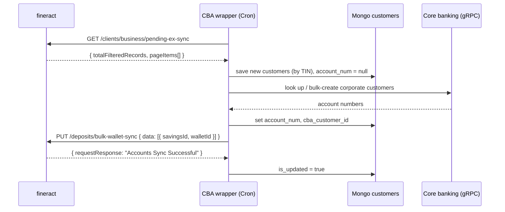
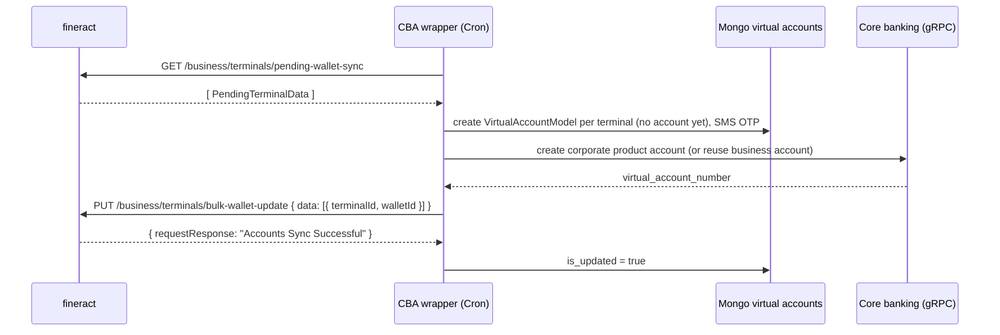

# TMS ↔ CBA sync flow

This is the reference for how the CBA wrapper, the TMS wrapper and the TMS backend (fineract-provider) talk to each other. It covers the six endpoints the CBA wrapper calls through its `CorePayRestController` and `TmsCoreWalletAccount` Feign clients.

It was traced from source on 2026-11-27. Use it as the starting point for changes to this flow, and update it when the flow changes.

| App | Repo | Role in this flow |
|---|---|---|
| **CBA wrapper** | `IdeaProjects/TMS_CBA_WRAPPER1` (Spring Boot, MongoDB) | Polls fineract, creates customers and accounts on core banking (gRPC), and writes account numbers back to fineract |
| **TMS wrapper** | `IdeaProjects/TMSBE-MicroService-Java1234u/tms-wrapper` (port 8100) | Backend for the TMS admin portal. Creates the businesses and terminals in fineract that later show up as "pending". **Not on the path of the six calls below.** |
| **TMS backend** | `IdeaProjects/TMSBE123/fineract-provider` (Apache Fineract fork, `/fineract-provider/api/v1`) | Source of truth for clients, savings accounts and terminals. Serves all six endpoints. |

---

## 1. Who calls whom

**The CBA wrapper calls fineract directly.** The TMS wrapper doesn't expose or forward any of the six paths:
- The only matches for these paths in that project are in its own copy of the CBA wrapper (`TMSBE-MicroService-Java1234u/cba-wrapper`).
- `tms-wrapper` only has POST endpoints for the portal, under `/v1/...`.

**Base URL.**

| Environment | `corepay.api.base.url` |
|---|---|
| Live (`pos-helmchart/cbawrapper/values.yaml`, `COREPAY_API_BASE_URL`) | `https://203.161.43.149:8443/fineract-provider/api/v1` (fineract) |
| `application-local.properties` | `localhost:8083/`, with the fineract URL commented out underneath |

**Authentication.** Fineract requires two things on every `/api/**` call:
- a tenant, either the `Fineract-Platform-TenantId` header or a `tenantIdentifier` query parameter (otherwise 400),
- and an authenticated user with `TWOFACTOR_AUTHENTICATED` (`SecurityConfig`).

None of the six paths is on fineract's permit-all list. The CBA wrapper adds both headers to **every** Feign client through a global `RequestInterceptor` (`Configuration/FeignConfig.java` → `FeignHeaders.getHeaders()`):

```
Authorization: Basic <service user cbaserviceext, hard-coded in FeignHeaders.java>
Fineract-Platform-TenantId: default
```

- `CoreFeignClientInterceptor` in the Feign clients' configuration is an empty class and adds nothing.
- The `feign.auth` property that `FeignHeaders` reads is unused; the credentials are hard-coded.
- **Each endpoint checks permissions as the `cbaserviceext` user.** Changing that user's roles or password breaks every sync.

**Errors.** Fineract errors go through `CoreErrorDecoder`, which throws `AuthenticationException` (401) or `PlatformDomainRuleException` (anything else). The crons catch these and write an `ErrorLogsModel` row (Mongo `error_logs`) with a `type` per job.

### How the TMS wrapper feeds this flow

```
TMS portal ─▶ TMS wrapper POST /v1/clients   ─▶ fineract POST /clients/business     (create business/merchant/agent)
TMS portal ─▶ TMS wrapper POST /v1/terminals ─▶ fineract POST /business/terminals   (create terminal)
```

The TMS wrapper forwards the logged-in portal user's `Authorization` and `Fineract-Platform-TFA-Token`, and its `CoreFeignClientInterceptor` adds the tenant header. Once fineract activates those records, they meet the "pending" rules in sections 2.1 and 3.1 and the CBA wrapper picks them up.

---

## 2. Client (business) wallet sync

All four jobs below are `@Scheduled(cron = "*/20 * * * * *")` in `Services/Cron.java`, so they run every 20 seconds, independently.



### 2.1 `GET /clients/business/pending-ex-sync`

**CBA wrapper.**
- Client: `CorePayRestController.getPending()` returns `PendingRequestResponse`.
- Caller: `Cron.getCustomersFromCorePay()`.

**Fineract.**
- Resource: `ClientsBusinessApiResource.getClientsForExternalWalletSync` (`@Path("/clients/business")`). It needs **READ_CLIENT** permission.
- Service: `ClientBusinessReadPlatformServiceImpl.getClientsForExternalWalletSync`, which selects from **`m_all_clients_view`** (`db/changelog/tenant/simplify/0013_all_clients_view.xml`).
- Optional query parameters (`displayName`, `tin`, `startPeriod`, `endPeriod`, `offset`, `limit`). The CBA wrapper sends none of them, so every pending client comes back in one page.

**What "pending" means** (the view's `WHERE`):

```sql
m_client.status_enum = 300                 -- client active
AND m_savings_account.status_enum = 300    -- its default savings account active
AND m_client.legal_form_enum IN (2, 4, 38) -- business / merchant / agent legal forms
AND (m_savings_account.external_id IS NULL OR TRIM(external_id) = '')  -- no wallet yet
```

Only the **default** savings account (`m_client.default_savings_account`) is joined. `tin` comes from `secondLevelKYC`, `incorp_no` from `m_client_non_person`, and `country_of_reg` is hard-coded to `"NIGERIA"`.

**Response.**

```json
{
  "totalFilteredRecords": 1,
  "pageItems": [
    { "id": 12, "savingsId": 34, "displayName": "Acme Ltd", "firstname": "...", "middlename": null, "lastname": "...",
      "dateOfBirth": "2015-03-01", "mobileNo": "080...", "emailAddress": "a@acme.ng", "tin": "1234567-0001",
      "incorpNo": "RC123456", "countryOfRegistration": "NIGERIA" }
  ]
}
```

**What the CBA wrapper does with it** (`getCustomersFromCorePay`):
1. Returns if the list is empty.
2. Looks up which TINs already exist in Mongo `customers` (`findByAccountId`, which despite its name queries by `tin`).
3. For each item **with a TIN not yet saved**, saves a new `CustomersModel` built by `getCustomersModel(...)`:
   - `firstName` and `companyName` fall back to `displayName`;
   - SMS and email flags are set from whether a phone number or email exists;
   - `savingsId` comes from the response;
   - `account_num` stays null.
   It then marks the matching `MerchantData` (by TIN) as `uploaded = true`.
4. Items **without a TIN, or whose TIN is already saved,** are logged as `CorePay_CREATION` "TIN is not available". The message is wrong for the already-saved case, and these rows are logged again every 20 s for as long as fineract keeps returning them.

### 2.2 Creating the core banking account (no fineract call)

`Cron.updateCustomerAccountNumFromCba()` takes Mongo customers with `account_num == null`:
- **Customers already on core banking** are updated with their account number.
- **The rest** are created in bulk with `customerService.createCustomers(...)` (gRPC). Successful rows get `account_num` and `cba_customer_id`; failures are logged as `CBA_CREATION`.

### 2.3 `PUT /deposits/bulk-wallet-sync`

**CBA wrapper.**
- Client: `CorePayRestController.postCustomers(CustomerData)`.
- Caller: `Cron.updateCustomersToCorePay()`, which takes customers where `account_num != null AND is_updated == false`.

**Request.** One item per customer. `walletId` is the core banking account number.

```json
{ "data": [ { "savingsId": 34, "walletId": "6018917534" } ] }
```

**Fineract.**
- Resource: `DepositsBusinessApiResource.syncSavingsAccounts` (`@Path("/deposits")`). This is the command `SAVINGSACCOUNT` / `BULK_SYNC_WALLETS`, so the user needs the matching permission and the call goes through the maker-checker/command log.
- Handler: `BulkSyncWithExternalWalletCommandHandler` → `DepositApplicationBusinessProcessWritePlatformServiceJpaRepositoryImpl.bulkSyncWithExternalWallet`.
- For each item it loads the savings account by `savingsId` (404 if it doesn't exist).
  - **If `external_id` is blank,** it sets `external_id = walletId`.
  - **Otherwise** it only logs a warning; the existing wallet is never overwritten.
- It saves everything in one `saveAll`; a failure returns 403 "Could not complete request".

**Response.**

```json
{ "requestResponse": "Accounts Sync Successful" }
```

The CBA wrapper looks for exactly this string. When it matches, it sets `is_updated = true` on **every** customer it selected, including ones it didn't send (known issue 2).

Setting `external_id` removes the client from `pending-ex-sync`. It also makes the client's terminals eligible for `pending-wallet-sync` (3.1).

### 2.4 `POST /clients` (on demand, not a cron)

**CBA wrapper.**
- Client: `CorePayRestController.createCustomer(CreateCustomerRequest)` returns `CreateCustomerResponse`.
- Caller: `OnboardingController.createCustomerFromEchannel`, exposed as `GET /api/v1/neptunepay/create-customer-from-echannel` with a JSON body. It adds a customer that already has a core banking account (from eChannel) to the TMS.

**Request** (fineract's standard create-client body):

```json
{ "officeId": 1, "legalFormId": 2, "fullname": "AdaObi", "externalId": 123, "mobileNo": "080...",
  "emailAddress": "a@x.ng", "active": true, "address": [ { "addressTypeId": 1, "addressLine1": "..." } ],
  "locale": "en", "dateFormat": "dd MMMM yyyy", "activationDate": "...", "submittedOnDate": "..." }
```

**Fineract.**
- Resource: standard `ClientsApiResource.create` (`@Path("/clients")`), which logs the `CLIENT`/`CREATE` command.
- Service: `ClientWritePlatformServiceJpaRepositoryImpl.createClient`.
- It returns `{ officeId, clientId, resourceId, savingsId? }`, where **`resourceId` is the client ID**. `savingsId` is only set when a savings product is part of the request.

**Afterwards** the CBA wrapper saves a Mongo `CustomersModel`:
- `account_num` is the eChannel account (already set), so the customer goes straight to `updateCustomersToCorePay` (2.3).
- `savingsId` is set to `response.resourceId`, which is the client ID (known issue 3).
- `clientId` is `response.clientId`.
- `legalFormId` maps to the reply label: 38 → Merchant, 2 → Business, otherwise Agent.

---

## 3. Terminal wallet sync



### 3.1 `GET /business/terminals/pending-wallet-sync`

**CBA wrapper.**
- Client: `TmsCoreWalletAccount.getPending()` returns `List<PendingTerminalData>`.
- Caller: `Cron.getVirtualTerminalRecords()`.

**Fineract.**
- Resource: `BusinessTerminalApiResource.retreiveTerminalsPendingWalletSync` (`@Path("/business/terminals")`). It needs **READ_TERMINAL** permission.
- Service: `BusinessTerminalReadServiceImpl.retrieveTerminalsAwaitingWalletSync`, with `PendingTerminalsMapper`.

**What "pending" means:**

```sql
m_terminal.status = 300                        -- terminal active
AND msa.external_id IS NOT NULL                -- the terminal's entity's default savings account is already wallet-synced (2.3)
AND m_terminal.wallet_id IS NULL               -- terminal has no wallet yet
```

The joins are:
- `m_terminal.entity_id` → `m_client mc` (the terminal's merchant or agent),
- `mc.default_savings_account` → `msa`,
- `mc.external_id` → `m_client mcb` (the parent business, if any),
- `mcb.default_savings_account` → `msab`.

**A terminal only appears after its owner's client wallet sync (section 2) has finished.** No pagination or filters.

**Response** (fields the mapper fills; others are null):

```json
[ { "id": 5, "terminalId": "2NEP0001", "switchTerminalId": "...", "parentEntityName": "Acme Ltd", "terminalName": "Till 1",
    "serialNo": "PB0123", "parentWalletId": "6018917534", "parentSavingsId": 34, "status": "ACTIVE",
    "businessName": "Acme Holdings", "businessSavingsId": 30, "businessWalletId": "6018000000" } ]
```

`PendingTerminalData` on the CBA side also declares `menuId`, `latitude`, `longitude`, `entityType` and `staffId`. The mapper selects `t.latitude, t.longitude, t.menu_id` but never passes them to `TerminalData.instance`, and it never selects a staff ID, so all five always arrive as null.

**What the CBA wrapper does with it** (`getVirtualTerminalRecords`): for each terminal whose `parentSavingsId` matches a Mongo customer's `savingsId`, and which has no `VirtualAccountModel` for its `terminalId` yet, it:
1. picks the terminal's `MerchantData` (by `terminalId`, otherwise by the customer's TIN), and skips the terminal if there isn't one;
2. creates a `VirtualAccountModel`:
   - `account_name` = `parentEntityName + "_" + terminalName`;
   - `rsm` = `staffId`;
   - `parent_id` / `parent_account` = the customer's `cba_customer_id` / `account_num`;
   - `customerUpdateRequired = true` when the merchant uses the business account;
   - an 8-digit OTP, which it hashes;
3. marks the merchant `terminalCreated` and `uploaded`;
4. sends the OTP by SMS.

### 3.2 Creating the terminal account (no fineract call)

These jobs don't call fineract:
- **`Cron.updateVirtualAccount()`** takes one virtual account without a number at a time:
  - **If the merchant uses the business account** (`useAcct`) and no terminal account has been created yet, it reuses the parent account and toggles it as the POS settlement account.
  - **Otherwise** it creates a corporate product account on core banking (`getCorporateCustomerAcctNum`).
  - Either way it sets `virtual_account_number` and emails the password.
- **`updateVirtualAccountToCustomerAsync`** and **`updateVirtualAcct`** handle the shared-account and eBiz push cases.

### 3.3 `PUT /business/terminals/bulk-wallet-update`

**CBA wrapper.**
- Client: `TmsCoreWalletAccount.postWallets(CustomerData)`.
- Caller: `Cron.updateVirtualAccountToCorePay()`, which takes virtual accounts where `virtual_account_number != null AND is_updated == false`.

**Request:**

```json
{ "data": [ { "terminalId": "2NEP0001", "walletId": "1020304050" } ] }
```

**Fineract.**
- Resource: `BusinessTerminalApiResource.syncSavingsAccounts`. This is the command `TERMINAL` / `BULK_WALLETS`, so the user needs the matching permission.
- Handler: `BulkUpdateExternalWalletCommandHandler` → `BusinessTerminalWriteServiceImpl.bulkSyncWithExternalWallet`.
- For each item it calls `terminalRepository.findOneByTerminalId(terminalId)`.
  - **If `wallet_id` is blank,** it sets `wallet_id = walletId`.
  - **Otherwise** it only logs a warning.
- It saves everything in one `saveAll`; a failure returns 403.

**Response:** `{ "requestResponse": "Accounts Sync Successful" }`.

The CBA wrapper marks every sent virtual account `is_updated = true` on **any non-null** response; it doesn't check the string. Setting `wallet_id` removes the terminal from `pending-wallet-sync`.

---

## 4. `GET /business/terminals/{serialNo}/settings` (on demand)

**CBA wrapper.**
- Client: `TmsCoreWalletAccount.getTerminalMenus(serialNo)` returns `MenuDetails { menuData, terminalProfile }`.
- Callers:
  - `SettingsController.getMenuData`, at `GET /api/v1/settings/fetch-terminal-menu/{serialNo}`. It returns the result as-is to the POS.
  - `TransactionController.logTransactionDispute`, at `POST /api/v1/pos/log-dispute`. It uses `terminalProfile.id` as the fineract terminal ID on the dispute.

**Fineract.**
- Resource: `BusinessTerminalApiResource.retrieveTerminalSettings`. It needs **READ_TERMINAL** permission.
- Service: `BusinessTerminalReadServiceImpl.retrieveTerminalSettings`:
  1. loads `m_terminal` by `serial_no` with its client (`TerminalSettingsMapper`);
  2. gets the business logo, where `businessId = mc.external_id`, via `imageBusinessWritePlatformService.retrieveImage("clients", businessId)`, and puts it in `terminalProfile.logo`;
  3. loads the menu with `businessMenuReadService.retrieveOne(menuId)` into `menuData`.
- Logo and menu failures are only logged. An unknown serial number gives `TerminalNotFoundException` (404), which `CoreErrorDecoder` turns into `PlatformDomainRuleException`.

**Response:**

```json
{
  "menuData": { "id": 3, "menuName": "Default", "menuList": [ ... ] },
  "terminalProfile": { "id": 5, "terminalId": "2NEP0001", "switchTerminalId": "...", "parentEntityName": "Acme Ltd",
                       "legalForm": "...", "menuId": 3, "businessId": 30, "serialNo": "PB0123", "walletId": "1020304050",
                       "terminalName": "Till 1", "status": "ACTIVE", "merchantCode": "...", "logo": "<image data>" }
}
```

---

## 5. State fields that drive the flow

| Where | Field | Meaning |
|---|---|---|
| fineract `m_savings_account.external_id` | Client wallet (core banking account no.) | Blank → client is in `pending-ex-sync`. Set by `bulk-wallet-sync`. |
| fineract `m_terminal.wallet_id` | Terminal wallet | Null (and parent `external_id` set) → terminal is in `pending-wallet-sync`. Set by `bulk-wallet-update`. |
| Mongo `customers.account_num` | Core banking account | Null → `updateCustomerAccountNumFromCba` creates or finds it |
| Mongo `customers.is_updated` | Pushed to fineract | false → `updateCustomersToCorePay` sends it |
| Mongo `virtual_accounts.virtual_account_number` | Terminal account | Null → `updateVirtualAccount` creates it |
| Mongo `virtual_accounts.is_updated` | Pushed to fineract | false → `updateVirtualAccountToCorePay` sends it |

End to end for one merchant:
1. The portal creates the business and terminal through the TMS wrapper; fineract activates them.
2. `pending-ex-sync` lists the business.
3. The core banking account is created.
4. `bulk-wallet-sync` sets `external_id`.
5. `pending-wallet-sync` lists the terminal.
6. The terminal account is created.
7. `bulk-wallet-update` sets `wallet_id`.

---

## 6. Known issues found while tracing

These are from reading the code; none is verified against live data yet. Check each one before fixing it.

1. **Hard-coded fineract credentials.** The Basic auth header is hard-coded in `FeignHeaders.java` (`feign.auth` is unused). It should come from `COREPAY_API_SECRET` / `feign.auth`, and the service user's password should be rotated.
2. **Merchant customers are never wallet-synced.**
   - In `updateCustomersToCorePay` the filter keeps only customers **without** a `MerchantData` row (`!merchantMap.containsKey(tin)`). The `useAcct` / `businessAcct` override below it therefore never runs, because `merchant` is always null.
   - After a successful call, the loop still marks **all** selected customers `is_updated = true`, including the merchants that weren't sent.
   - Those clients keep a blank `external_id` in fineract, so they stay in `pending-ex-sync` forever, and their terminals never reach `pending-wallet-sync`.
   - The condition looks inverted.
3. **`savingsId` from the create-client endpoint is the client ID.**
   - `createCustomerFromEchannel` stores `response.getResourceId()` (the client ID) as `savingsId`.
   - `bulk-wallet-sync` then loads a savings account with the client's ID: either 404 or **the wrong account**.
   - `CreateCustomerResponse` has no `savingsId` field, and the create request has no savings product, so fineract may not create a savings account at all. Without one, the client also never matches `m_all_clients_view`.
   - Smaller issues on the same endpoint: `fullname` joins first and last name with no space, and it's a `GET` with a JSON body.
4. **Pending-terminal fields never filled.** `PendingTerminalsMapper` doesn't set `menuId`, `latitude`, `longitude`, `entityType` or `staffId`. `VirtualAccountModel.rsm` (from `staffId`) is always null.
5. **No null check in `bulk-wallet-update`.** An unknown `terminalId` makes `findOneByTerminalId` return null, and `terminal.getWalletId()` throws. One bad item fails the whole batch.
6. **Repeated error logs.** `getCustomersFromCorePay` logs every already-saved or TIN-less pending client as "TIN is not available" every 20 s.
7. **No paging.** `pending-ex-sync` and `pending-wallet-sync` are called without `limit`; a large backlog comes back in one response.
8. **Duplicate code.** `TMSBE-MicroService-Java1234u/cba-wrapper` is another copy of the CBA wrapper. Confirm which one is deployed before changing either.
